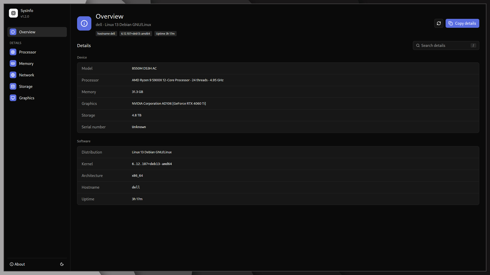
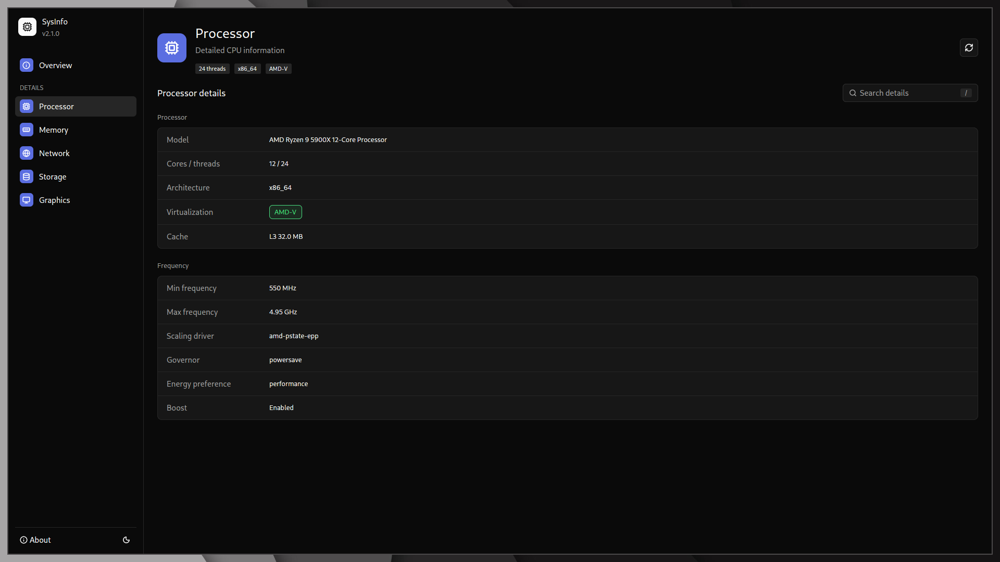
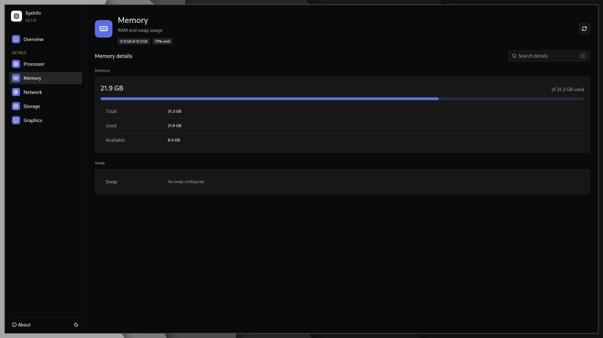
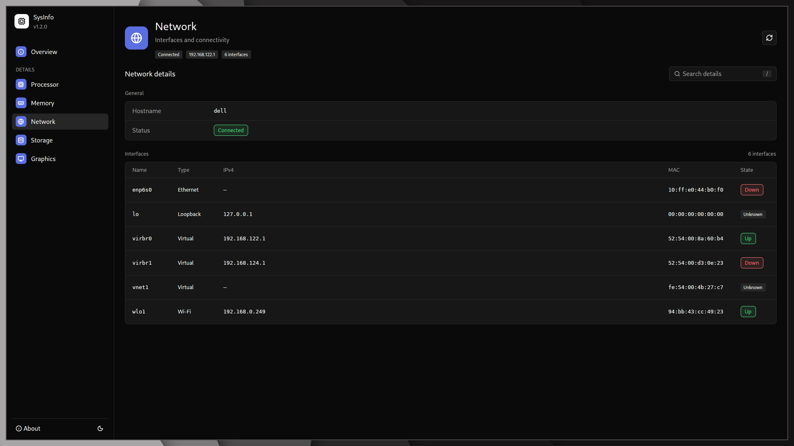
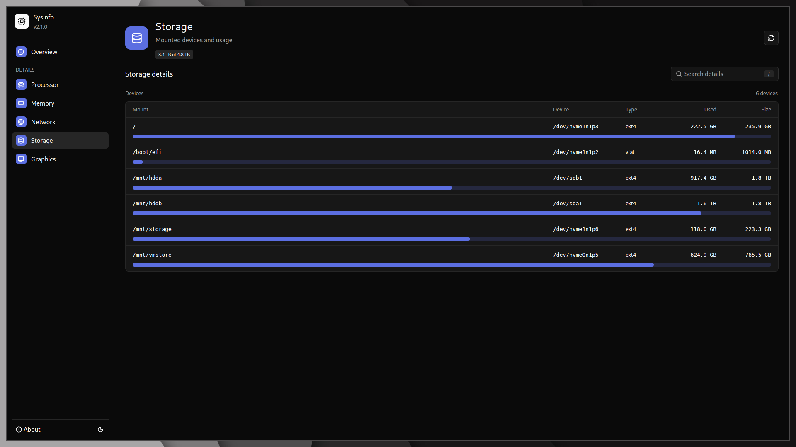
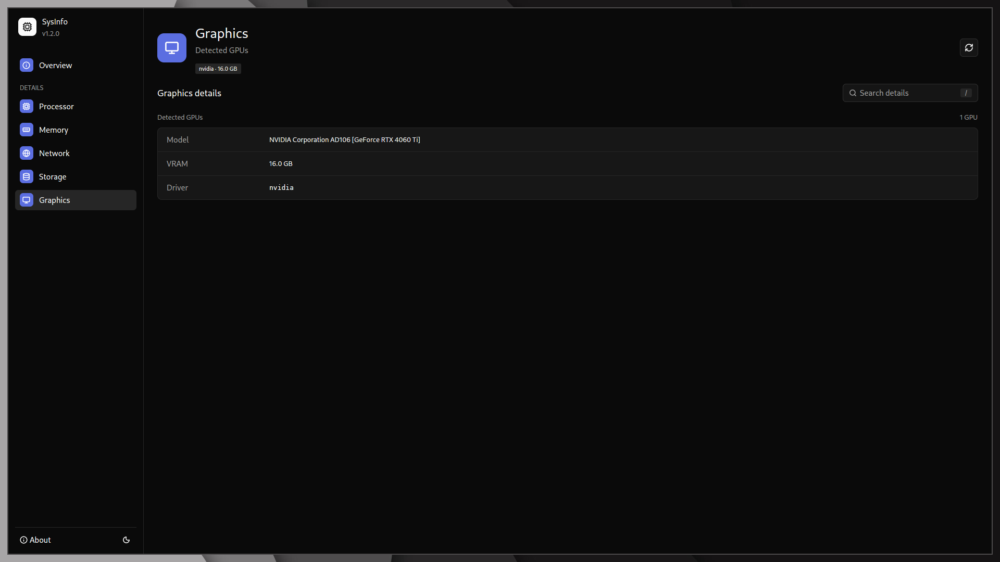
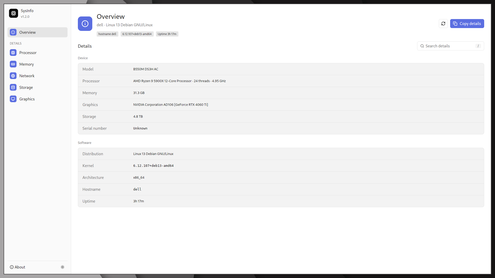

# SysInfo Viewer - System Information Viewer for Linux

[](https://github.com/fa-saikat/sysinfo-viewer/actions/workflows/rust.yml)
[](https://github.com/fa-saikat/sysinfo-viewer/releases)
[](LICENSE)

A fast, native system information viewer for the Linux desktop. See your OS, CPU, memory, network, storage, and GPU in one clean window, with search, one-click copy, light/dark themes, and honest fallbacks instead of fake data.

Built with Rust + [GPUI](https://github.com/zed-industries/zed) (via `gpui-kit`).



## Why SysInfo?

- **Everything in one place.** No terminal flags to memorize, no five different tools.
- **Honest by design.** If a value can't be detected, it says `Unknown`. It never invents numbers.
- **Fast and native.** Manual snapshot model: collects on launch and on Refresh, no background polling.
- **Share-friendly.** `Copy details` gives you a plain-text Overview report for bug reports and forums.
- **Private by default.** The device serial is masked (`••••••••••`) until you explicitly reveal it.

## Features

### Six tabs, zero clutter

| Tab | What you get |
| --- | --- |
| **Overview** | Device model, CPU summary, memory, primary GPU, total storage, serial (masked by default), plus distro, kernel, architecture, hostname, and uptime. `Copy details` copies exactly what's on screen. |
| **Processor** | Model, cores/threads, max frequency, architecture, virtualization badge (`AMD-V` / `Intel VT-x` / `Unknown`), L3 cache, and a per-core frequency chart. |
| **Memory** | RAM total / used / available with usage bar, plus a separate Swap section that honestly handles the no-swap case. |
| **Network** | Hostname, `Connected` status, and a sorted interface table: type (`Ethernet` / `Wi-Fi` / `Loopback` / `Virtual`), IPv4, MAC, and `Up` / `Down` / `Unknown` state badges. |
| **Storage** | Every mounted device with mount point, device node, filesystem type, used/size figures, per-device usage bars, and a deduplicated total (bind mounts don't double-count). |
| **Graphics** | Detected GPUs with model, VRAM, and kernel driver. Multi-GPU aware: AMD VRAM comes from sysfs, NVIDIA VRAM from `nvidia-smi` matched by PCI bus ID, Intel integrated correctly reports shared memory. |

### Thoughtful touches that matter

- **Global search:** one toolbar box filters every tab. Press `/` to jump to it, see `N of M` live counts, and the app auto-switches to the first tab with a match.
- **Manual Refresh:** header button re-collects the snapshot and confirms with a notification. The header also shows data freshness (`Just now`, `12s ago`).
- **Light + dark themes:** one-click toggle in the sidebar footer; accent and charts adapt.
- **Tool-missing guidance:** if `lspci` isn't installed, a notice explains how to install `pciutils` and Refresh, instead of showing an empty Graphics tab.
- **Tooltips and keyboard:** icon buttons carry tooltips; `/` focuses search from anywhere.
- **About dialog:** version, developer, copyright, and license at a glance from the sidebar footer.

## Screenshots

Dark theme (light theme ships the same six views, see `design/screenshots/light/`):

| Overview | Processor |
| --- | --- |
|  |  |

| Memory | Network |
| --- | --- |
|  |  |

| Storage | Graphics |
| --- | --- |
|  |  |

Light-theme Overview for comparison:



## Install

### Requirements

- Linux with X11 or Wayland (Linux-only; no Windows or macOS support planned)
- Rust stable (tested with 1.98) + Cargo
- Optional but recommended for full GPU details:
  - `pciutils` (provides `lspci`)
  - `nvidia-smi` (NVIDIA VRAM only; AMD uses sysfs, Intel iGPU is reported as shared)

On Debian/Ubuntu:

```sh
sudo apt install pciutils
```

### Option A: Debian package (recommended)

```sh
git clone https://github.com/fa-saikat/sysinfo-viewer.git
cd sysinfo-viewer
cargo install cargo-deb
cargo build --release
./scripts/build-deb.sh
sudo apt install ./target/debian/*.deb
```

This installs the binary to `/usr/bin/sysinfo-viewer`, a desktop entry (`System Info Viewer` in your app menu), and the app icon.

### Option B: Run from source

```sh
git clone https://github.com/fa-saikat/sysinfo-viewer.git
cd sysinfo-viewer
cargo run --release
```

The binary lands at `./target/release/sysinfo-viewer` with `cargo build --release`.

## Usage

Launch from your app menu (**System Info Viewer**) or:

```sh
sysinfo-viewer
```

| Action | How |
| --- | --- |
| Switch tabs | Sidebar: Overview, Processor, Memory, Network, Storage, Graphics |
| Search everything | Type in `Search details`, or press `/` anywhere |
| Copy Overview report | `Copy details` (top right on Overview), pastes as `Label: value` lines |
| Refresh data | Refresh icon in the header (re-collects + notifies) |
| Toggle theme | Sun/moon icon in the sidebar footer |
| Reveal serial | `Show` / `Hide` next to Serial number (stays masked by default) |
| About | `About` in the sidebar footer |

Two launch switches help testing and screenshots (dark Overview is the default):

| Variable | Effect |
| --- | --- |
| `SYSINFO_TAB=processor` | Open on that tab (`overview`, `processor`/`cpu`, `memory`/`mem`/`ram`, `network`/`net`, `storage`/`disk`, `graphics`/`gpu`) |
| `SYSINFO_THEME=light` | Open in light theme |

Example:

```sh
SYSINFO_TAB=graphics SYSINFO_THEME=dark sysinfo-viewer
```

## How data is collected

One call, `SystemSnapshot::collect()`, backs every tab. Sources:

- OS / kernel / distro / uptime / hostname via `sysinfo` + OS release info
- CPU model, topology, frequencies, cache, virtualization flags from `/proc/cpuinfo` and `/sys`
- Memory and swap from `sysinfo`
- Network interfaces (name, MAC, state, type) from the system, IPv4 via `if-addrs`
- Storage mounts and usage from the mount table (deduplicated, sorted by mount point)
- GPUs from `lspci -k` (model + driver), then VRAM per driver:
  - `amdgpu` → `mem_info_vram_total` in sysfs (exact)
  - `nvidia` → `nvidia-smi` output matched to the same PCI bus ID
  - `i915` / `xe` → system RAM reported as `(Shared)`
  - anything else → `Unknown`

Every collector degrades to `Unknown` / empty rather than failing the whole snapshot when a file or tool is missing.

## Project layout

```
src/
  main.rs       - app bootstrap (theme, accent, key bindings, window)
  lib.rs        - shared data layer used by the binary and the tests
  theme.rs      - brand accent + light/dark toggle
  assets.rs     - icon registry + app asset source
  tab.rs        - the six tabs: labels, icons, slugs
  search.rs     - search inventory (row texts, counts, auto-switch)
  ui/
    mod.rs      - view module wiring
    root.rs     - app state, header, toolbar, notices, render
    sidebar.rs  - brand mark, navigation, footer (About, theme)
    views.rs    - the six tab bodies
    library.rs  - shared primitives (tiles, tags, badges, bars)
    dialogs.rs  - About dialog
  data/         - collectors + formatters, zero UI dependencies
    mod.rs / fixture.rs - snapshot shape + test fixtures
    os.rs / cpu.rs / memory.rs / network.rs / storage.rs / gpu.rs
tests/
  harness.rs    - integration tests over fixture machines
docs/
  testing.md    - fixture harness guide
design/screenshots/ - dark/ + light/ baselines for all six tabs
scripts/
  build-deb.sh  - build the .deb via cargo-deb + lintian
  capture.sh    - screenshot matrix (all tabs x both themes)
  generate-changelog.sh - changelog helper
packaging/      - .desktop entry, changelog, maintainer scripts
```

## Contributing

PRs welcome. The fast loop:

```sh
cargo test        # unit + full-stack harness (no display needed)
cargo build --release
```

- `docs/testing.md` explains the fixture harness (`SYSINFO_SYS_ROOT` + stub `bin/` on `PATH`).
- `scripts/capture.sh` regenerates `design/screenshots/` (needs a display or `xvfb-run`, plus `grim` on Wayland or `import` on X11). Please review the full tab × theme matrix before calling a UI change done.
- CI (`.github/workflows/rust.yml`) runs `cargo build` + `cargo test` on pushes/PRs to `main`.

## License & credits

MIT, see [LICENSE](LICENSE).

- Developer: **Fahim A Saikat**
- Copyright: **© 2026 JaduPc**
